# Shemwild

Building software and exploring new ideas.

---

---

### 🛠️ Tech Stack &amp; Skills

| Category | Technologies |
| :--- | :--- |
| **Languages &amp; Core** |    |
| **Frameworks &amp; Web** |   |
| **Databases &amp; Systems** |   |

---

### 📂 /works

- [**github.com/Shemwild**](https://github.com/Shemwild) &mdash; Open Source Repositories &amp; Experiments

### 🔗 /connect

